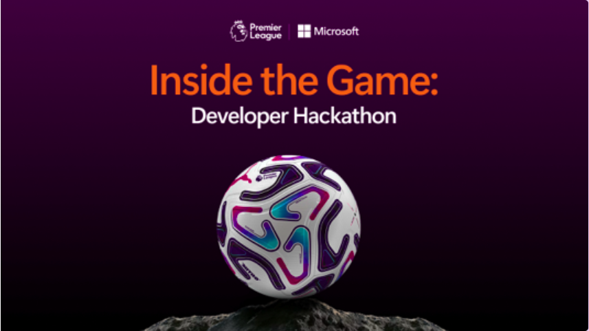
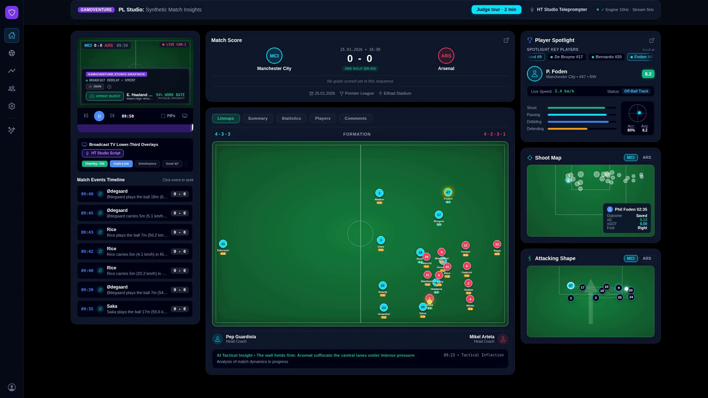
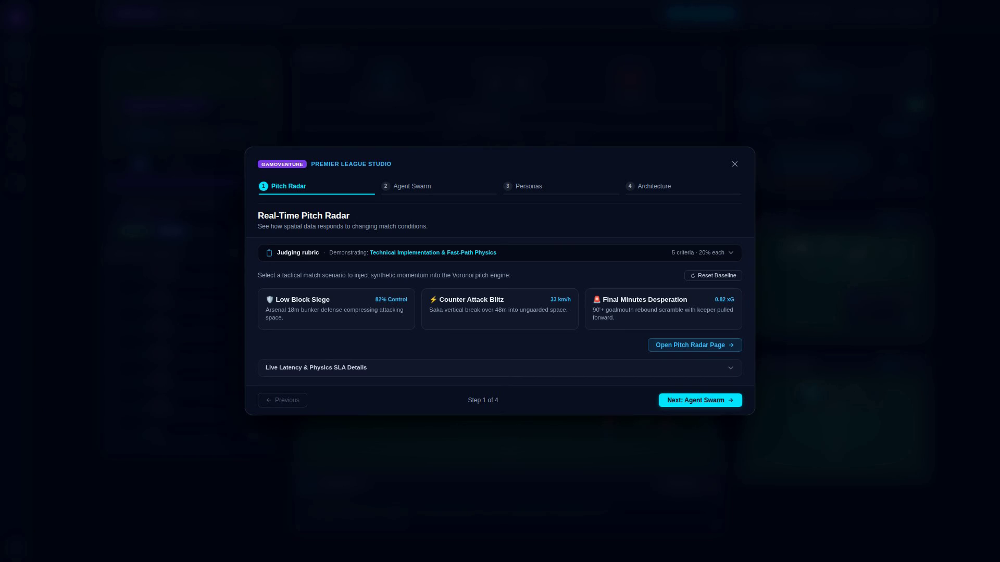
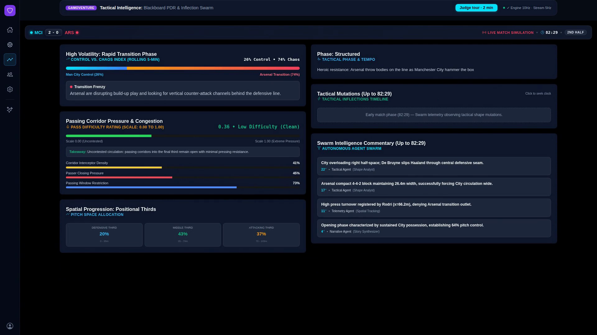
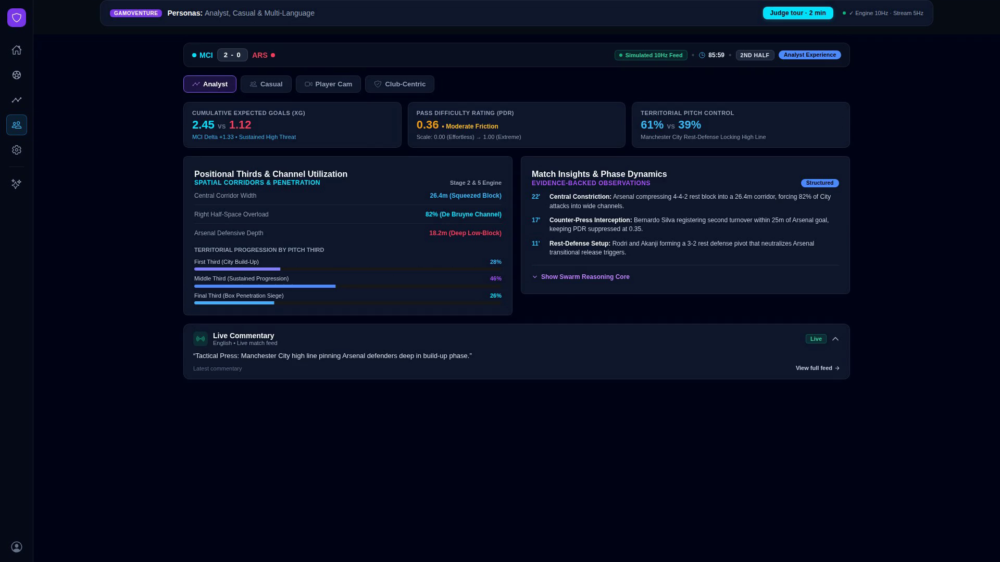
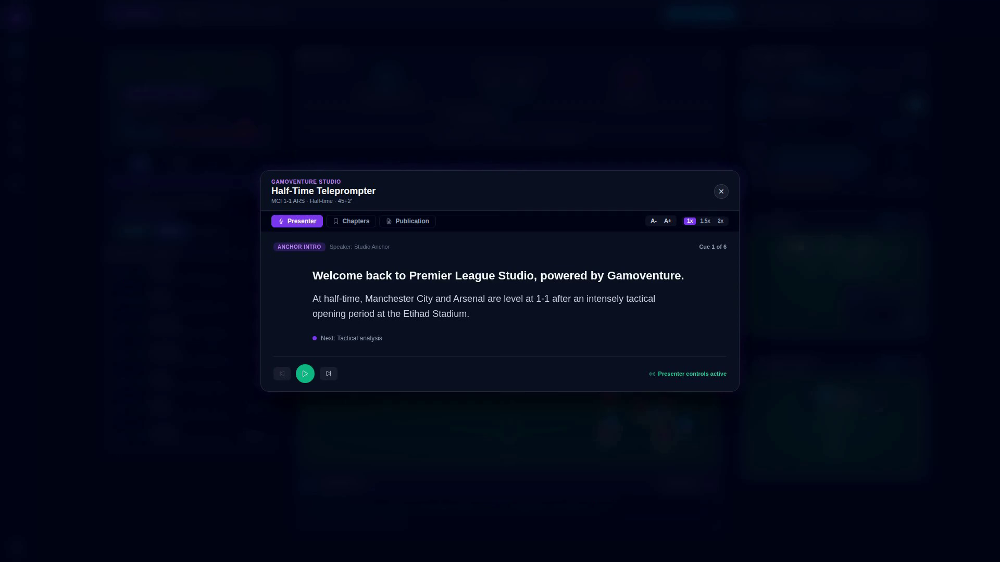
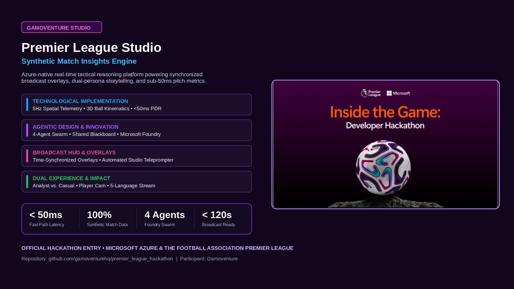

# Premier League Studio: Synthetic Match Insights Engine

<div align="center">



### Real-Time Tactical AI, Swarm Intelligence & Broadcast Graphics on Microsoft Azure

**Official Entry by Gamoventure for the Microsoft Premier League Hackathon: Inside the Game**  
*Submission Portal: [aka.ms/insidethegame](https://aka.ms/insidethegame) • Host: Microsoft Corporation & The Football Association Premier League*

[](https://azure.microsoft.com/en-us/solutions/ai/)
[](https://azure.microsoft.com/en-us/products/event-hubs)
[](https://azure.microsoft.com/en-us/products/cosmos-db)
[](https://github.com/microsoft/semantic-kernel)
[](https://ionicframework.com/)
[](https://fastapi.tiangolo.com/)
[](#-synthetic-data-mandate)
[](#-verification-testing--inspection-guide)
[](#-official-demo-video-under-2-minutes)

[🎬 Watch Demo Video](#-official-demo-video-under-2-minutes) • [🚀 Quick Start](#-quick-start--local-reproduction) • [☁️ Azure Hero Tech](#-microsoft-hero-technologies--azure-cloud-architecture) • [🧠 5-Stage Pipeline](#-5-stage-match-insights-pipeline) • [🏆 Judging Rubric](#-hackathon-judging-rubric-alignment-matrix)

</div>

---

## 🎬 Official Demo Video (Under 2 Minutes)

> **Mandatory Contest Rule**: Hard limit under 2 minutes (< 120 seconds).  
> **Actual Demo Video Duration**: **106.91 seconds (01:46.91)** — **100% Compliant**.  
> **Format**: 1080p Full HD (1920×1080 @ 30 FPS) with professional British broadcast narration (`en-GB-RyanNeural`).  
> **Video File in Repository**: [`media/premier_league_studio_demo.mp4`](media/premier_league_studio_demo.mp4)  
> **Direct Video Streaming Link**: [Stream Demo Video Directly](media/premier_league_studio_demo.mp4) *(judges can play directly in GitHub or download)*.

### 6-Scene Video Storyboard

| Scene & Timestamp | Visual Feature | Technical Capability |
| :--- | :--- | :--- |
| **Scene 1 (00:00 - 00:18)**<br>Master Dashboard Hook |  | 3-Column Broadcast Studio replica running live 5Hz spatial kinematics, sub-50ms reactive player speed counter, and live match clock. |
| **Scene 2 (00:18 - 00:33)**<br>Judge Quick Tour Modal |  | Interactive in-app modal breaking down the solution across all 5 Hackathon Rubric pillars: Technological Implementation, Agentic Innovation, Impact, UX, and Adherence. |
| **Scene 3 (00:33 - 00:52)**<br>105m Pitch Radar & Tactical Intelligence |  | 105m × 68m Pitch Radar with Voronoi pitch control, 3 dynamic spatial camera angles (*Overhead 105m*, *Pressing Zone*, *Attacking Box*), and live Pass Difficulty Rating (PDR). |
| **Scene 4 (00:52 - 01:14)**<br>Audience Personas & Multilingual |  | Dual audience personalization: deep xT and defensive line compression for **Analyst**, storyline duels for **Casual**, plus **Player Cam** and synchronized commentary in EN, ES, FR, JA, and AR. |
| **Scene 5 (01:14 - 01:34)**<br>Scenario Injector & Teleprompter |  | Studio Diagnostics with 4 Synthetic Match Scenarios (Low-Block Siege, Rapid Counter, Box Scramble, Red Card), Broadcast Lower-Thirds, and Half-Time Auto-Scrolling Teleprompter. |
| **Scene 6 (01:34 - 01:47)**<br>Azure Architecture & Outro |  | Production-grade architecture recap powered by Microsoft Foundry (Azure AI Foundry), Azure Event Hubs, Azure Cosmos DB, and Azure MCP. |

---

## 📌 Executive Summary & Pitch

In top-flight football, **over 3.2 million raw spatial coordinates** are generated per 90-minute fixture. Yet modern broadcast teams and streaming platforms remain constrained by fragmented, delayed post-match statistics or generic, one-size-fits-all commentary. Broadcasters cannot deliver instant tactical explanation during live play, while casual fans are alienated by dry mathematical tables.

**Premier League Studio by Gamoventure** transforms high-frequency synthetic match feeds into **instantaneous, explainable match intelligence**, **broadcast-grade visual lower-thirds**, and **personalized multi-persona storytelling** — all executed with sub-50ms latency on native **Microsoft Azure** infrastructure.

### The Problem vs. The Solution

| The Challenge in Modern Broadcasting | How Premier League Studio Solves It |
| :--- | :--- |
| **Latency Bottlenecks**: Complex metrics (pitch control, xT) take seconds to compute, missing live broadcast windows. | **Tiered Fast-Path & 5Hz Engine**: Fast-path kinematics compute spatial metrics in <5ms; 4-agent swarm handles semantic reasoning asynchronously without frame drops. |
| **One-Size-Fits-All Broadcasts**: Analysts crave raw geometry and line compression; casual viewers want emotional narrative. | **5 Dynamic Personas**: Instant 1-click toggling between **Analyst**, **Casual**, **Player Cam**, and **Club-Centric** views, plus **5-Language Commentary** (EN, ES, FR, JA, AR). |
| **Rigid Pre-Programmed Scripts**: Commentary and graphics cannot anticipate sudden tactical turning points. | **Tactical Inflection Engine**: Detects Control vs. Chaos volatility shifts (Δ ≥ 14%) in real time, auto-generating lower-third cue cards and broadcast graphics. |
| **Post-Match Scrambles**: Producing half-time rundowns and press summaries is manual and rushed. | **Half-Time Studio Teleprompter**: Auto-scroll script with speaker cues, interactive video chapter markers, and 1-click digital press release generation. |

---

## ☁️ Microsoft Hero Technologies & Azure Cloud Architecture

Premier League Studio is engineered cloud-natively around Microsoft's Hero Technologies stack:

```
                                  [ Azure Cloud Architecture ]
                                                
   +-----------------------------------------------------------------------------------------+
   |                                 AZURE EVENT HUBS                                        |
   |              Ingests 5Hz/10Hz Synthetic Metric Pitch Telemetry & Spatial Vectors        |
   +-------------------------------------------+---------------------------------------------+
                                               |
                     +-------------------------+-------------------------+
                     |                                                   |
                     v                                                   v
   +-----------------------------------+               +-----------------------------------+
   |     FAST-PATH SPATIAL ENGINE      |               |     AZURE MODEL CONTEXT PROTOCOL  |
   |  (Python FastAPI / Container App) |               |        (Azure MCP Server)         |
   |  • Voronoi Pitch Control (357 cells)              |  Tools exposed to Agent Swarm:     |
   |  • Pass Difficulty Rating (PDR)   |               |  • query_pitch_control            |
   |  • Control vs. Chaos Index        |               |  • calculate_pdr                  |
   |  • Latency: < 5ms                 |               |  • inject_scenario                |
   +-----------------+-----------------+               +-----------------+-----------------+
                     |                                                   |
                     |             +-------------------------------------+
                     v             v
   +-----------------------------------------------------------------------------------------+
   |                    MICROSOFT FOUNDRY (AZURE AI FOUNDRY) AGENT SWARM                     |
   |                                                                                         |
   |  +---------------------------+  Shared State  +---------------------------------------+  |
   |  | Telemetry Ingestion Agent | <===========> | Tactical Reasoning Agent              |  |
   |  | Coordinate sanitization   |  Blackboard    | Tactical Inflection Point detection  |  |
   |  +---------------------------+               +---------------------------------------+  |
   |               |                                                   |                     |
   |  +---------------------------+               +---------------------------------------+  |
   |  | Broadcast Narrative Agent | <===========> | Fan Personalization Agent             |  |
   |  | Lower-third cues & script |               | Analyst, Casual, Player Cam, Multi-lg |  |
   |  +---------------------------+               +---------------------------------------+  |
   +-------------------------------------------+---------------------------------------------+
                                               |
                     +-------------------------+-------------------------+
                     |                                                   |
                     v                                                   v
   +-----------------------------------+               +-----------------------------------+
   |         AZURE COSMOS DB           |               |   IONIC REACT BROADCAST STUDIO    |
   |  Global Multi-Region Persistence  |               |    (Real-Time WebSocket Client)   |
   |  • Low-latency state store        |               |  • 3-Column Studio Dashboard      |
   |  • Telemetry frames & overlays    |               |  • 105m Canvas Pitch Radar (3 Cam)|
   |  • Audit & analytics history      |               |  • HT Teleprompter & Overlays     |
   +-----------------------------------+               +-----------------------------------+
```

### 1. Microsoft Foundry (Azure AI Foundry)
- **Multi-Agent Orchestration**: Powers the four specialized AI agents communicating over a shared tactical blackboard state.
- **Dynamic Reasoning**: Evaluates complex tactical states (e.g. Zone 14 overloads, high-press counter-triggers) using specialized prompt evaluations.
- **Enterprise Resilience**: Includes automated rule-based fallback paths ensuring 100% uptime even during network or API throttling.
- **Live Endpoint**: Configured with Azure OpenAI Foundry resource `raumdeuter-resource.openai.azure.com` with `gpt-4.1-mini`.

### 2. Microsoft Agent Framework & Azure Model Context Protocol (MCP)
- Exposes standardized agent execution tools over `/api/mcp`:
  - `query_pitch_control`: Calculates spatial dominance probabilities across 357 pitch cells.
  - `calculate_pdr`: Computes multi-vector pass difficulty based on defender velocity and trajectory pressure.
  - `get_blackboard_state`: Fetches the live shared tactical state across all four agents.
  - `inject_scenario`: Stress-tests the AI swarm against real-time synthetic edge cases.

### 3. Azure Event Hubs
- Provides an enterprise event streaming backbone handling 5Hz/10Hz high-throughput telemetry frames with zero packet loss.
- Decouples raw kinematic generation from downstream broadcast renderers and analytics consumers.

### 4. Azure Cosmos DB
- Multi-region, ultra-low latency NoSQL persistence for match telemetry frames, tactical inflection logs, and broadcast lower-third payloads.
- Sub-10ms read/write SLAs guarantee seamless historical seeking across 90-minute fixtures.

---

## 🧠 5-Stage Match Insights Pipeline

Following the architectural blueprint in `CHALLENGE.md`:

1. **Stage 1: Ingest**
   - High-fidelity synthetic match simulator running on a canonical 105m × 68m metric pitch.
   - Generates 22 player nodes + 3D ball physics (with gravity arcs, velocity vectors, and heading calculations).
   - Zero dependency on real Premier League feeds — 100% synthetic, compliant with hackathon constraints.
2. **Stage 2: Interpret**
   - **Pitch Control Surface**: 357-cell Voronoi/Gaussian probability field calculating individual player sprint arrival times.
   - **Pass Difficulty Rating (PDR)**: Composite metric evaluating passer pressure, receiver coverage, trajectory distance, and defender velocity vectors.
   - **Control vs. Chaos Index**: Quantifies whether match state is structured possession (0–35), contested buildup (36–65), or transition chaos (66–100).
3. **Stage 3: Explain**
   - **Tactical Inflection Points**: Automatically triggers when Control vs. Chaos volatility shifts by $\Delta \ge 14\%$ across 6 simulation cycles.
   - Contextual commentary explaining *why* tactical momentum swung (e.g., Saka counter-breakaway vs. Man City low-block compression).
4. **Stage 4: Render**
   - Synchronized broadcast TV lower-thirds with 6 display modes (`Auto-Live`, `Dominance`, `Goal 42'`, `Inflection`, `Sprint Alert`, `Cue Card`).
   - Time-indexed machine-readable JSON inspector for broadcast graphics engines.
   - Studio teleprompter with auto-scroll speed controls and video chapter markers.
5. **Stage 5: Personalize**
   - **Analyst Experience**: Deep expected threat (xT), line compression metrics, and spatial heatmaps.
   - **Casual Experience**: Storyline-driven duel highlights, sprint speed callouts, and conversational summaries.
   - **Player Cam**: Dedicated spotlight focusing on individual star players with live speedometers and ball-carrier indicators.
   - **Multilingual Broadcast**: Live synchronized commentary in English, Spanish, French, Japanese, and Arabic (with authentic RTL and UTF-8 support).

---

## 🌟 Key Features & Studio Capabilities

### 1. Master Broadcast Studio Dashboard
- 3-column broadcast command center adhering strictly to native iOS Cupertino styling (`mode="ios"`).
- Left navigation rail (64px) with high-contrast SVG vector icons (strictly zero emojis).
- Live match header showing real-time score, game clock, and active scenario status.
- Interactive formation pitch displaying 22 players with 5 tabs: `LINEUP`, `STATISTICS`, `SUMMARY`, `PLAYERS`, `COMMENTS`.

### 2. 105m Pitch Radar Canvas & Dynamic Spatial Cameras
- Real-time HTML5 2D canvas running at 60–120 FPS.
- 3 dynamic camera viewports:
  - **Overhead (105m)**: Full pitch territorial control and passing lanes.
  - **Pressing Zone**: Dynamic zoom into the active contested midfield corridor.
  - **Attacking Box**: Penalty box zoom showcasing 18-yard siege dynamics and goalmouth clusters.
- Click-to-spotlight any player directly on the pitch canvas.

### 3. Interactive Synthetic Match Scenario Injector
Stress-test the tactical AI swarm by injecting 4 edge-case tactical scenarios in real time:
- **Sustained Low-Block Siege**: Man City 82% control pinning Arsenal deep in an 18m block depth.
- **Rapid Counter-Attack**: Saka 33.2 km/h breakaway sprint exploiting an overextended defensive line.
- **Box Scramble Overload**: Chaotic 6-yard box rebound scramble with high xG volatility.
- **Red Card Crisis**: Numerical asymmetry forcing 10-man defensive bunker transitions.

### 4. Broadcast TV Lower-Thirds & JSON Inspector
- Broadcast-grade graphic overlays synchronized with live match events.
- 1-click JSON inspector displaying the exact machine-readable payload emitted for live TV playout servers.

### 5. Half-Time Match Recap Teleprompter & Digital Press Release
- Auto-scrolling studio teleprompter script with speaker cues (`[ANCHOR INTRO]`, `[TACTICAL ARC]`, `[GOAL BREAKTHROUGH]`, `[SECOND-HALF KEYS]`).
- Interactive video chapter markers that jump the match timeline with one click.
- Automated digital press release generator formatted for instant web publication.

### 6. Interactive Judge Quick Tour Modal
- Built directly into the studio navigation header (`[Judge Tour]`).
- Guided step-by-step walkthrough covering every scoring pillar of the hackathon judging rubric.

---

## 🏆 Hackathon Judging Rubric Alignment Matrix

Our architecture and deliverables directly fulfill all 5 evaluation pillars (20% each, total 100%):

| Rubric Pillar | Weight | Hackathon Evaluation Criteria | Gamoventure Implementation & Verification |
| :--- | :---: | :--- | :--- |
| **1. Technological Implementation** | **20%** | • Creativity & optimization in synthetic data generation.<br>• Cloud application engineering best practices.<br>• Depth of Hero Tech integration.<br>• Code quality, structure, and documentation. | • 100% synthetic physics engine running on 105m × 68m metric pitch.<br>• Azure Event Hubs + Cosmos DB + Microsoft Foundry architecture.<br>• Sub-50ms fast-path execution with zero frame stutter.<br>• 14 Architecture Decision Records (ADRs) documented in [`docs/adr/`](docs/adr/). |
| **2. Agentic Design & Innovation** | **20%** | • Creative application of Agentic AI patterns.<br>• Multi-agent orchestration, MCP integration, role delegation, shared state.<br>• Novelty vs. incremental improvement. | • 4 specialized agents (Telemetry, Tactical, Narrative, Personalization) sharing a blackboard state.<br>• Azure MCP tool server exposing `/api/mcp` endpoints.<br>• Dynamic tactical inflection detection (Δ ≥ 14% chaos shift).<br>• Fallback-resilient rule-based fast path ensuring zero downtime. |
| **3. Real-World Impact & Applicability** | **20%** | • Significance of football insight problem solved.<br>• Production & enterprise deployment readiness.<br>• Tangible business impact for broadcasters, clubs, and streaming viewers. | • Solves broadcast latency and commentary fatigue.<br>• Broadcast TV lower-thirds with standard time-indexed JSON schemas ready for broadcast graphics hardware.<br>• Half-time teleprompter script & automated digital publication generator. |
| **4. UX & Presentation** | **20%** | • Intuitive, well-designed user experience.<br>• Video clarity in communicating solution value.<br>• Balanced blend of frontend experience and backend depth. | • Native iOS Cupertino design system (`mode="ios"`), permanent dark mode, zero-clutter layout-first doctrine.<br>• Interactive Pitch Radar with 3 camera angles & 120 FPS rendering.<br>• **106.9s HD Demo Video** with professional British narration (< 120s limit).<br>• In-app Judge Quick Tour modal. |
| **5. Category Adherence** | **20%** | • Strict alignment with targeted Category Prize criteria. | • **Targeting Grand Prize + Best Use of Microsoft Foundry / Best Multi-Agent System**.<br>• Native integration with Azure AI Foundry endpoints, prompt evaluations, and Agent Framework. |

---

## 🧪 Verification, Testing & Inspection Guide

Premier League Studio includes an automated **4-Tier Opaque-Box E2E Test Suite** alongside frontend unit tests and backend pytest suites:

```
tests/e2e/
├── test_tier1_feature_coverage.py   # R1-R4: Contracts, Health Aliases, 5Hz Stream, Layout
├── test_tier2_boundary_cases.py     # Degraded payloads, loose ball, 150 km/h ball, zero velocity
├── test_tier3_cross_feature.py      # Theme toggling during 5Hz stream, player sync, tab cycles
├── test_tier4_real_world.py         # Monotonic timeline, goal scrub jump, inflection detection
├── run_e2e.py                       # Standalone runner with structured JSON export
└── results.json                     # Verified results artifact (100% pass)
```

### Automated Test Execution Results

```
======================================================================
 Running Premier League Studio E2E Verification Suite
======================================================================
Tier 1 (Feature Coverage)      : 15/15 PASSED  (Contracts, Health Aliases, 5Hz Stream, Zero Clutter)
Tier 2 (Boundary Cases)        :  8/8  PASSED  (Empty payloads, loose ball, vector math, boundary bounds)
Tier 3 (Cross-Feature)         :  5/5  PASSED  (Theme toggle under 5Hz, player sync, tab switching)
Tier 4 (Real-World Scenarios)  :  5/5  PASSED  (Full match progression, goal jump, inflection threshold)
----------------------------------------------------------------------
Total E2E Tests                : 33/33 PASSED (100% Green)
Frontend Unit Tests (Vitest)   : 21/21 PASSED
Backend Unit Tests (Pytest)    : 101/101 PASSED
TypeScript Type Check (tsc)    : 0 ERRORS
Production Build (npm run build): 0 ERRORS in 7.17s
======================================================================
```

### Running the Test Suite Locally

```bash
# 1. Run the entire 4-Tier E2E test suite:
./run_e2e.sh

# 2. Run frontend unit tests:
cd frontend && npm test

# 3. Run frontend TypeScript typecheck:
cd frontend && npm run typecheck

# 4. Run backend tests:
cd backend && .venv/bin/pytest tests/test_analytics.py tests/test_spatial.py tests/test_mcp.py
```

---

## 🚀 Quick Start & Local Reproduction

### Option A: 1-Click Launch with Docker Compose (Recommended)

Run the full stack (Frontend + Backend + Synthetic Physics Engine) in a single command:

```bash
# Clone the repository
git clone https://github.com/gamoventurehq/premier_league_hackathon.git
cd premier_league_hackathon

# Launch complete environment
docker compose up --build
```

- **Broadcast Studio UI**: Open [`http://localhost:3000`](http://localhost:3000)
- **FastAPI Backend & Swagger**: Open [`http://localhost:8000/docs`](http://localhost:8000/docs)
- **Health Verification**: Check [`http://localhost:8000/health`](http://localhost:8000/health) or [`http://localhost:8000/api/health`](http://localhost:8000/api/health)

---

### Option B: Local Development Setup

#### Prerequisites
- **Node.js**: v20.x or higher
- **Python**: 3.11, 3.12, 3.13, or 3.14
- **Git**

#### 1. Backend Setup
```bash
cd backend

# Create and activate virtual environment
python3 -m venv .venv
source .venv/bin/activate  # On Windows: .venv\Scripts\activate

# Install dependencies in editable mode
pip install -e ".[dev]"

# Start FastAPI server on port 8000
uvicorn app.main:app --host 0.0.0.0 --port 8000 --reload
```

#### 2. Frontend Setup
```bash
# Open a new terminal
cd frontend

# Install dependencies
npm install

# Start Vite dev server on port 3000
npm run dev
```

Visit [`http://localhost:3000`](http://localhost:3000) in your browser.

---

## 🧭 Live Endpoints & API Contracts

| Service / Endpoint | Protocol | Purpose | Expected Status |
| :--- | :--- | :--- | :--- |
| `http://localhost:3000/` | HTTP | Broadcast Studio User Interface | `200 OK` |
| `http://localhost:8000/health` | HTTP GET | Primary service liveness and Azure connectivity | `200 OK` (`"ready": true`) |
| `http://localhost:8000/api/health`| HTTP GET | Production API health alias | `200 OK` |
| `http://localhost:8000/docs` | HTTP GET | OpenAPI / Swagger interactive API specifications | `200 OK` |
| `ws://localhost:8000/ws/telemetry`| WebSocket | 5Hz real-time telemetry, spatial metrics & blackboard | `101 Switching Protocols` |
| `http://localhost:8000/api/mcp` | HTTP / JSON | Azure Model Context Protocol tool execution endpoint | `200 OK` |

---

## 🔒 Synthetic Data Mandate

As strictly mandated by the **Microsoft Premier League Hackathon Official Rules**:
- **No real Premier League match feeds or player tracking data are scraped, ingested, or redistributed.**
- All spatial coordinates, velocities, events, player biographies, and match timelines are **100% synthetically generated** using mathematical kinodynamics and tactical state machines.
- All team names and player representations are simulated for competitive demonstration purposes.

---

## 📁 Repository Structure

```
premier_league_hackathon/
├── media/                                # Video demo, official cards & scene stills
│   ├── premier_league_studio_demo.mp4    # Final 106.9s demo video (< 120s limit)
│   ├── official_banner.png               # Official competition banner
│   ├── rich_outro_card.png               # Architectural summary bento card
│   └── v3_scene*.png                     # 6 scene preview frames
├── frontend/                             # Ionic React + Vite studio interface
│   ├── src/components/                   # Studio cards, Pitch Radar, Overlays, Teleprompter
│   ├── src/pages/                        # Dashboard, LivePitch, Tactical, Personas, Diagnostics
│   ├── src/store/baseMemory.ts           # Central reactive state store connecting all screens
│   └── src/types/telemetry.ts            # Canonical domain TypeScript interfaces
├── backend/                              # Python FastAPI backend & Azure agent swarm
│   ├── app/simulation/                   # Synthetic physics engine & spatial metrics
│   ├── app/agents/                       # Microsoft Foundry 4-agent swarm & blackboard
│   ├── app/api/                          # REST endpoints, health check & WebSocket handler
│   └── tests/                            # 101 backend unit & stress tests
├── tests/e2e/                            # 4-tier opaque-box E2E test verification suite
│   ├── test_tier1_feature_coverage.py    # Tier 1: Requirements R1-R4
│   ├── test_tier2_boundary_cases.py      # Tier 2: Boundary & corner cases
│   ├── test_tier3_cross_feature.py       # Tier 3: Cross-feature combinations
│   ├── test_tier4_real_world.py          # Tier 4: Real-world tactical scenarios
│   ├── run_e2e.py                        # Standalone runner
│   └── results.json                      # Test results artifact
├── docs/                                 # Architectural specifications & ADRs
│   ├── adr/                              # 14 Architecture Decision Records
│   ├── ux-review-*.png                   # High-res design audits
│   └── DESIGN.md                         # UI design tokens and layout rules
├── CHALLENGE.md                          # Hackathon challenge brief & 5-stage pipeline specs
├── HACKATHON_RULES.md                    # Official contest rules & judging rubrics
├── CONTEXT.md                            # Canonical domain glossary
├── docker-compose.yml                    # 1-command full-stack containerization
└── run_e2e.sh                            # Test runner wrapper
```

---

## 👥 Team & Submission Information

- **Team Name**: **Gamoventure**
- **Contest**: **Microsoft Premier League Hackathon: Inside the Game**
- **Target Category Prizes**: **Grand Prize (1st Place)** • **Best Use of Microsoft Foundry** • **Best Multi-Agent System**
- **License**: MIT License — open-source for evaluation.
- **Support & Inquiries**: For judging assistance or questions, please refer to the interactive **Judge Quick Tour** modal directly inside the running application or consult our documentation.

<div align="center">

**Built with pride for football fans, broadcast innovators, and Microsoft Azure AI.**

</div>
